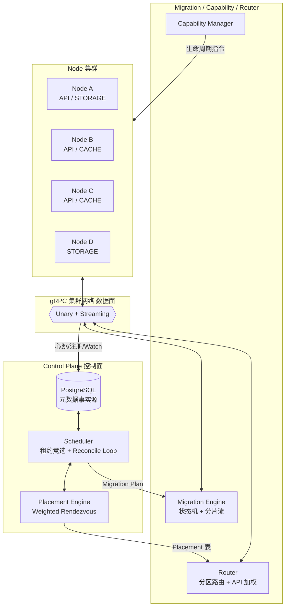
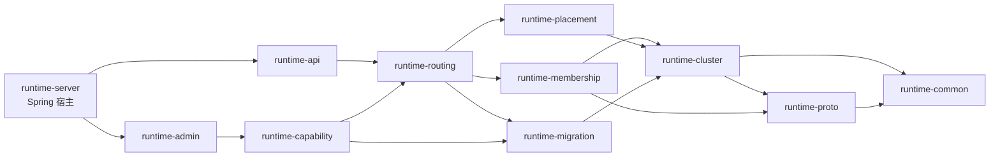
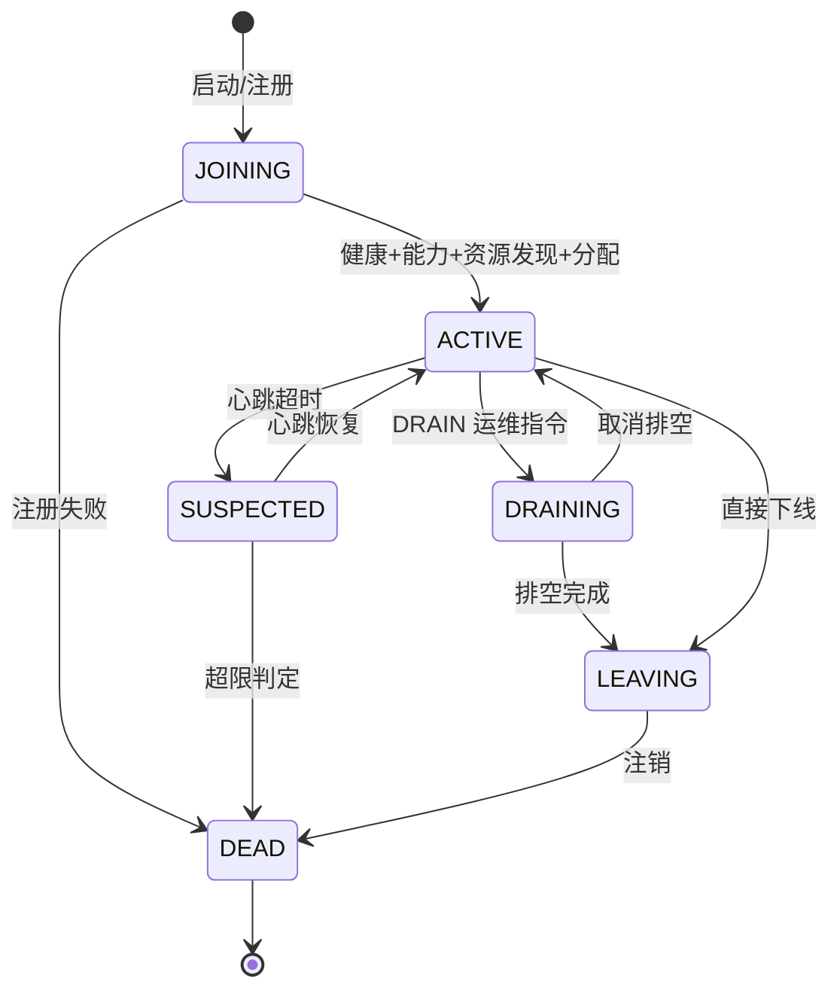
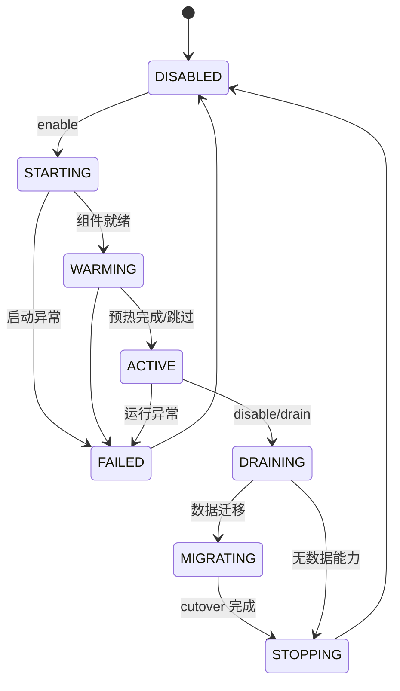
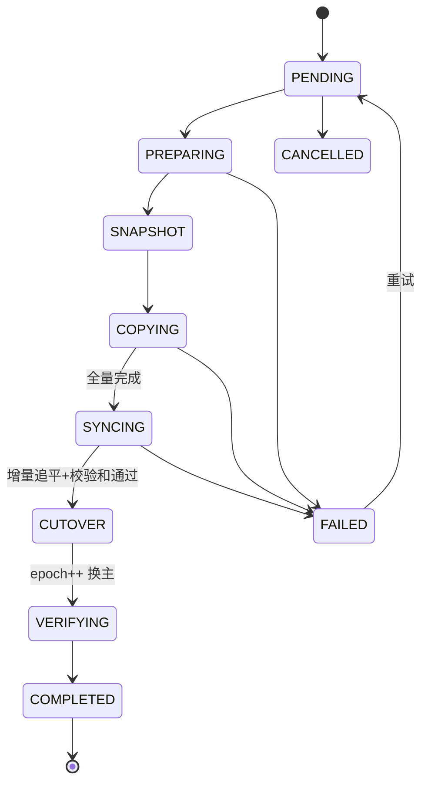
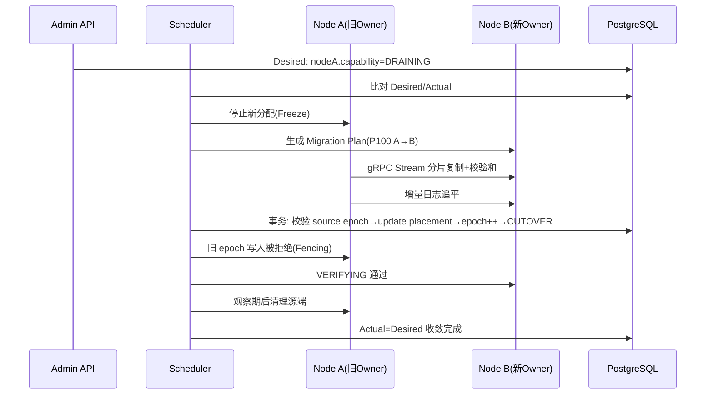
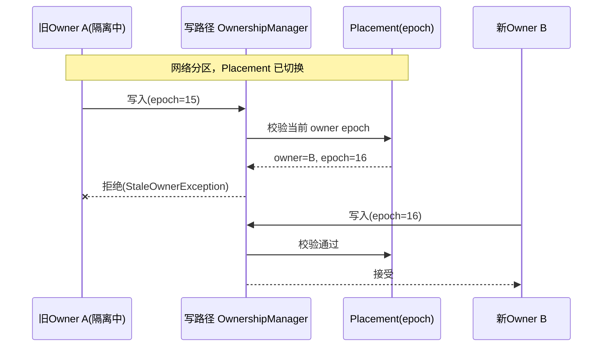

# distributed-runtime 架构图（Mermaid）

> 配套 `architecture.md` 使用。

## 1. 总体架构

## 2. 模块依赖

## 3. Node 生命周期

## 4. Capability 生命周期

## 5. Migration 状态机

## 6. 排空流程（DRAIN NODE A）

## 7. Split Brain 防护

