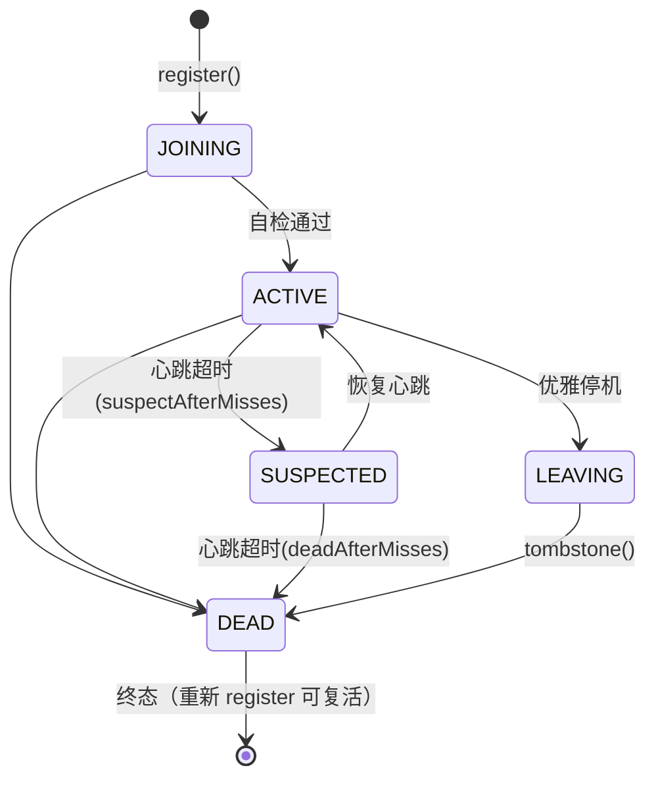
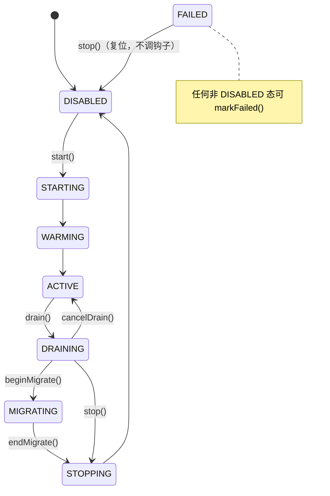
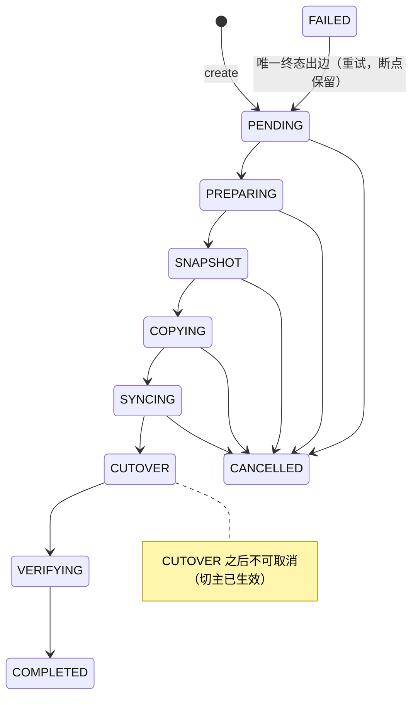

# 架构总览

> 本文是 runtime 模块的顶层架构说明。模块级细节见各子文档（[README.md](README.md) 导航）。

## 1. 定位与设计目标

runtime（distributed-runtime）是 ww 仓库内新增的**分布式应用基础运行时**框架，目标是：

1. **单节点可独立运行**（全能力自持），**多节点自动组成集群**（能力分布在任意节点子集）；
2. 任意 Capability 可在任意 Node 上启停、独立扩缩容、迁移；
3. 任何 Partition 都有明确 Owner，任何 Owner 变化都有 Epoch（Fencing）；
4. 任何迁移都可恢复（断点续跑），任何节点故障都能触发 Placement 重算；
5. 整个集群最终从**当前状态自动收敛到期望状态**（Desired → Actual Reconciliation）。

设计上借鉴 Kubernetes（Desired/Actual/Reconcile）、Redis Cluster（Partition/Sharding）、对象存储（Placement/Replication/Migration）与 Raft/Lease/Fencing 的思想，但自成一套 `Node + Capability + Partition + Placement + Epoch + Migration + Scheduler` 统一抽象。

**当前进度**：基础阶段（Phase 0~10 对应的骨架，Task 1~11）已完成并通过验收——86 个主类 + 43 个测试类、6 张 PG 表、5 个 gRPC 服务。Cache/Storage 真实能力接入为下一阶段（详见 [phase-record-foundation.md](../phase-record-foundation.md)）。

## 2. 核心抽象

| 抽象 | 定义 | 落地 |
|---|---|---|
| **Node** | 物理计算资源容器，不等于角色；携带 host/grpcPort/weight/资源快照 | `NodeInfo`（record）、`NodeRuntime`、`rt_node` 表 |
| **Capability** | 可运行能力（当前仅 `MOCK`，预留 CACHE/STORAGE/API/TASK） | `CapabilityModule` SPI、`CapabilityManager`、`rt_capability_state` 表 |
| **Partition** | 逻辑数据单元，`key → hash → partitionId`，默认 4096 个/能力 | `Partitioner`、`PartitionId` |
| **Placement** | 分区所有权映射（显式表，非计算式路由） | `PlacementEngine`、`PlacementStore`、`rt_partition_placement` 表 |
| **Epoch** | 所有权版本（Fencing Token），切主 +1，旧 Owner 写入被拒 | `Epoch`、`PlacementStore.cutover` CAS、`StaleEpochException` |
| **Migration** | 所有权转移：状态机 + gRPC 分片传输 + checkpoint | `MigrationEngine`、`rt_migration_task` 表 |
| **Scheduler** | Desired→Actual 收敛器，PG 租约竞选，无固定 Master | `ReconcileLoop`、`LeaseStore`、`rt_scheduler_lease` 表 |

## 3. 总体架构

```
                         PostgreSQL（控制面元数据，plain JDBC）
                    rt_node / rt_capability_state / rt_partition_placement
                    rt_scheduler_lease / rt_migration_task / rt_cluster_config
                              │
                    ┌─────────▼─────────┐
                    │  Scheduler Leader  │   ← rt_scheduler_lease 单行租约 CAS 竞选
                    │  ReconcileLoop     │      （任意节点可成为 Leader，无固定 Master）
                    │  Placement Engine  │
                    │  RebalancePlanner  │
                    └─────────┬─────────┘
                              │ Migration Plan（PartitionMove 列表）
          ┌───────────────────┼───────────────────┐
          ▼                   ▼                   ▼
   MigrationEngine      NodeCommandChannel    DesiredStateWriter
   （数据面搬运+cutover） （START/STOP/FREEZE）  （管理面只写期望态）
          └───────────────────┼───────────────────┘
                              │ gRPC 集群网络（数据面）
       ┌──────────────┬───────┴──────┬──────────────┐
       ▼              ▼              ▼              ▼
    Node A          Node B        Node C         Node D
   [MOCK 能力]    [MOCK 能力]    [MOCK 能力]    [无能力]
   Membership ──── Membership ── Membership ──── Membership（gossip 心跳双向流）
```

每个节点进程 = `runtime-server`（Spring Boot 薄宿主）组装以下 Spring-free POJO 组件：

```
┌─────────────────────────── Node 进程（runtime-server） ───────────────────────────┐
│  REST : /rt/*（Admin API）      gRPC : Health / ClusterControl / Membership / Migration │
│                                                                                    │
│  NodeRuntime ──► NodeRegistry ◄── MembershipService（心跳/故障检测/事件）            │
│       │              ▲                    │                                        │
│  OsResourceMonitor   │                    ▼                                        │
│       │         CapabilityManager ◄── ReconcileLoop（Leader 时收敛）                │
│       ▼              │    ▲              │        │                               │
│  ResourceSnapshot    ▼    │         MigrationEngine（虚拟线程 + 限流）               │
│                 MockCapability            │                                        │
│                      │                    ▼                                        │
│                PlacementView ◄──── PlacementStore / PlacementEngine                │
└────────────────────────────────────────────────────────────────────────────────────┘
```

## 4. 控制面 / 数据面严格分离

- **控制面**（PostgreSQL + Scheduler + gRPC 控制流）：Node/Membership/Capability/Placement/MigrationTask/Lease/Epoch 元数据。**数据库只是元数据事实源，禁止作为大数据搬运通道**。
- **数据面**（gRPC Streaming）：迁移分片流（4MB/片、SHA-256 checksum、ack 重发）。大数据一律 `A → gRPC Stream → B`。
- **管理面只写 Desired State**（`/rt/nodes/{id}/capabilities/{type}/desired`），实际状态由 Scheduler 收敛产生，禁止直接 UPDATE 底层状态。

## 5. 模块清单与分层

runtime-parent 聚合 9 个 Maven 模块，分层如下：

| 层 | 模块 | 职责 | Spring? |
|---|---|---|---|
| 基础层 | `runtime-common` | 值对象/枚举/异常/时钟（纯 POJO，仅 slf4j） | 否（enforcer 禁止） |
| 基础层 | `runtime-proto` | 5 个 .proto 契约 + gRPC 生成代码 + GrpcServerHost | 否（enforcer 禁止） |
| 领域层 | `runtime-cluster` | 节点状态机/注册表（内存+JDBC）/资源监控/NodeRuntime | 否 |
| 领域层 | `runtime-membership` | gRPC 心跳双向流/gossip 视图合并/故障检测/事件 | 否 |
| 领域层 | `runtime-capability` | 能力 SPI + 8 态生命周期状态机 + desired/actual 存储 | 否 |
| 领域层 | `runtime-placement` | 加权 HRW/Partitioner/PlacementStore CAS/RebalancePlanner | 否 |
| 领域层 | `runtime-scheduler` | Leader 租约/ReconcileLoop/命令通道/DesiredStateWriter | 否 |
| 领域层 | `runtime-migration` | 迁移 10 态状态机/引擎/gRPC 分片传输/断点续跑 | 否 |
| 组装层 | `runtime-server` | 唯一 Spring 宿主：装配 + 启停编排 + REST/gRPC 暴露 | **是**（唯一豁免） |

**依赖方向铁律**：`server → {scheduler, migration, capability, placement, cluster, membership} → {proto, common}`；任何核心模块不得反向依赖 server，核心模块间通过端口接口（`PlacementView`、`MigrationCoordinator`、`PeerDirectory`/`StateSink`）解耦。详见 [11-dependencies.md](11-dependencies.md)。

## 6. 三大状态机

### 6.1 Node 生命周期（`NodeStateMachine`，5 态）



- 同态跃迁一律非法；`DEAD` 为终态但可被 `register()` 重置为 JOINING/epoch=0（节点重启恢复）。
- 每次 `markState`/`tombstone` 使 `state_epoch` +1（乐观锁版本）。

### 6.2 Capability 生命周期（`CapabilityManager`，8 态）



- 钩子（start/warm/drain/stop）在命令线程同步调用，异常自动 `markFailed`。
- `freeze(boolean)` 是独立于状态机的维护开关（迁移前冻结停新写）。

### 6.3 Migration 任务状态机（`MigrationStateMachine`，10 态）



- 所有状态写入前必须经 `MigrationStateMachine.check` 校验，非法跃迁抛 `IllegalStateTransitionException`。
- 任务存储的 `transition` 以 `UPDATE ... WHERE state=?` CAS 写入，防并发修改。

## 7. 数据库表总览（PostgreSQL，全部幂等建表）

| 表 | 所属模块 | 主键 | 关键列 | 用途 |
|---|---|---|---|---|
| `rt_node` | cluster | node_id | state, state_epoch, weight, cpu/mem/disk 资源列, heartbeat_at | 节点注册表（含 DEAD 墓碑行） |
| `rt_cluster_config` | cluster | cfg_key | cfg_value, version | 集群配置 KV（预留，暂无读写实现） |
| `rt_capability_state` | capability | (node_id, capability) | desired, actual, updated_at | 期望态/实际态（收敛依据） |
| `rt_partition_placement` | placement | (capability, partition_id) | node_id, role, epoch, updated_at | 分区放置（epoch 为 fencing 依据） |
| `rt_scheduler_lease` | scheduler | id（恒 1，CHECK 约束） | owner, expires_at_ms | Leader 租约（单行表 CAS） |
| `rt_migration_task` | migration | task_id（BIGSERIAL） | capability, partition_id, from/to_node, state, checkpoint_offset, items_done, checkpoint_json | 迁移任务与断点 |

Schema 引导统一模式：`XxxSchema.bootstrap(DataSource)` 执行 classpath 下 `sql/rt_*.sql`（`CREATE TABLE IF NOT EXISTS` 幂等），并以 `pg_advisory_lock(4001, n)` 串行化跨节点并发建表（规避 PG 下 `CREATE TABLE IF NOT EXISTS` 的 pg_type 竞态）。

## 8. gRPC 服务总览（package `runtime.v1`）

| 服务 | RPC | 模式 | 服务端实现 | 用途 |
|---|---|---|---|---|
| `Health` | `Check` | unary | server 模块 `HealthServer` | 存活检查（detail 含 leader 状态） |
| `ClusterControl` | `StartCapability` / `StopCapability` / `Freeze` | unary | server 模块 `ClusterControlServer` | 调度器→节点的能力生命周期命令 |
| `Membership` | `Heartbeat` | **双向流** | membership 模块 `MembershipService` | 周期心跳 + 全量视图交换 |
| `Membership` | `Watch` | 服务端流 | 同上 | 成员变更事件订阅 |
| `Migration` | `TransferStream` | **双向流** | migration 模块 `MigrationServer` | 目标端写入（ack 重发） |
| `Migration` | `FetchPartition` | 服务端流 | 同上 | 源端分片拉取（支持 from_checkpoint） |
| `Migration` | `ControlTask` | unary | 同上 | 任务控制（cancel） |
| `Migration` | `ReportProgress` | 客户端流 | 同上 | 进度上报 |
| `PlacementWatch` | `WatchPlacements` | 服务端流 | **proto 已定义，实现为下一阶段** | 放置快照订阅 |

消息定义详见 [03-proto.md](03-proto.md)。

## 9. 一轮收敛时序（ReconcileLoop 核心流程）

```
Leader 节点（持有 rt_scheduler_lease 租约）每 reconcileIntervalMs（默认 2s）执行：

1. leaseStore.acquireOrRenew(self, ttl)   ──失败→ 本周期静默跳过（follower 待命）
2. for each CapabilityType:
   a. 计算 alive / desiredOn / actualOn / desiredAlive 集合
   b. 放置引导：primaries 为空且 desiredAlive 非空 → PlacementEngine.computePrimaries
      （加权 HRW）→ placementStore.replaceAll（epoch=0）
   c. 待上线（desiredOn − actualOn）：commands.startCapability(node, type)
      → 成功则 setActual(ACTIVE)
   d. 待下线（actualOn − desiredOn）：
      freeze(true) → 计算目标环 → planner.plan 过滤 from∈toStop 的 moves
      → migration.migrateAndWait(moves)（数据搬运 + PlacementStore.cutover CAS 切主）
      → 成功：freeze(false) + stopCapability + setActual(DISABLED)
      → 失败：保留现状（仍冻结），下周期重试
   e. 扩容重平衡（无待下线时）：plan(current, target)
      → shouldRebalance（移动比例 ≥ minMoveRatio 且过 cooldown）才执行迁移
3. Thread.sleep(min(renewIntervalMs, reconcileIntervalMs))
```

**幂等保证**：命令失败不抛异常（返回 false 下周期重试）；迁移任务复用活动任务不重复建；分片导入 upsert 幂等；切主以 epoch CAS 防竞态。

## 10. Fencing 闭环（防 Stale Owner / Split Brain）

```
key ──Partitioner(MD5 前 8 字节 % 4096)──► partition
partition ──PlacementStore.primaries──► owner(node, epoch)

写入路径（以 MockCapability.put 为例）：
  view.owner(cap, partition)
    ├─ 无属主                       → StaleEpochException
    ├─ 属主 ≠ self                  → StaleEpochException
    └─ 属主 epoch ≠ 请求 epoch      → StaleEpochException   ← 旧 Owner 的陈旧写入被拒
    └─ 通过 → data.put + 计数

切主路径：MigrationEngine CUTOVER 阶段
  placementStore.cutover(cap, partition, toNode, expectedEpoch)
    UPDATE ... SET node=?, epoch=epoch+1
    WHERE capability=? AND partition_id=? AND epoch=? AND node<>?   ← CAS
```

## 11. 故障恢复策略

| 场景 | 策略 |
|---|---|
| 节点宕机 | 心跳静默 > suspectTimeout（默认 3s）→ SUSPECTED；> deadTimeout（默认 6s）→ DEAD；Leader 侧 Reconcile 重算目标环（排除 DEAD）→ 生成迁移计划恢复 |
| Leader 宕机 | 租约过期（默认 TTL 10s）→ 其余节点 CAS 抢占接管（实测 ≤15s） |
| 迁移中断 | 任务状态 + checkpoint_offset + checkpoint_json 持久化；重启后 `MigrationEngine.resumeAll()` 断点续跑 |
| Split Brain | 旧 Owner 持旧 epoch 写入 → 写路径统一经 PlacementView 校验 → `StaleEpochException` 拒绝 |
| 控制面 DB 不可用 | 启动期 fail-fast（PG SELECT 1 检查）；运行期数据面以最后已知 placement 降级 |
| 并发建表 | `pg_advisory_lock` 串行化 5 个 Schema bootstrap |

## 12. 一致性分级

- **强一致**：Ownership/Placement epoch（CAS）、Lease（单行表乐观锁）、Migration 状态（WHERE state=? CAS）、Node state_epoch（乐观锁 + 重试）。
- **最终一致**：成员视图传播（gossip 悲观合并）、资源统计、调谐收敛本身（周期性幂等逼近）。

## 13. 关键设计决策速记

1. **POJO 核心 + 薄 Spring 宿主**：7 个核心模块零 Spring/JPA/Caffeine（maven-enforcer 构建期门禁），未来可脱离 Spring 独立运行；server 是唯一允许 Spring 的模块，配置经 `RuntimeProperties` 翻译为构造参数（防腐层）。
2. **Netty 钉版 4.1.100.Final**：grpc-netty 1.62.x 与 Spring Boot 4 BOM 管理的 Netty 4.2.x 不兼容（HTTP/2 HPACK 解码错误/巨型消息），runtime-parent 的 dependencyManagement 覆盖之。
3. **哈希算法为 MD5 前 8 字节构造 64 位值**（非 xxHash）：`Partitioner` 与 `WeightedRendezvousHash` 同族，保证 key→partition 与 partition→owner 两级映射稳定可复现。
4. **加权 HRW 公式 `score = -ln(h) × weight`**：相对旧 common-cluster 的 `RendezvousHash` 修正了两处数学错误（Long.MAX_VALUE 除数、权重方向），权重比例≈分得分区比例。
5. **租约表无 epoch 字段**：Leader 唯一性仅靠 `owner + expires_at_ms`；epoch 语义专属 Placement 表（fencing）。
6. **desired 只允许 ACTIVE/DISABLED 两个开关值**：中间态由节点状态机自治产出，管理面不可指定；且带"清空最后服务节点保护"。
7. **本模块不做 xxHash/4096 硬编码**：partitionCount 可配置（默认 4096 为设计基准）。
