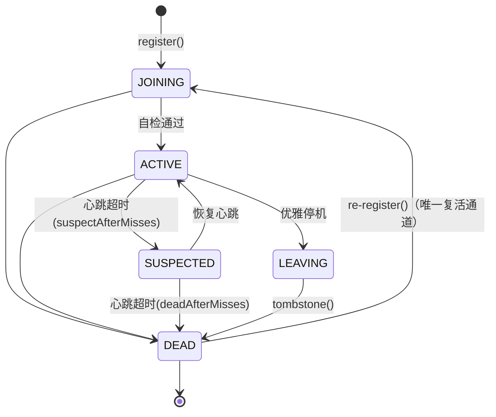
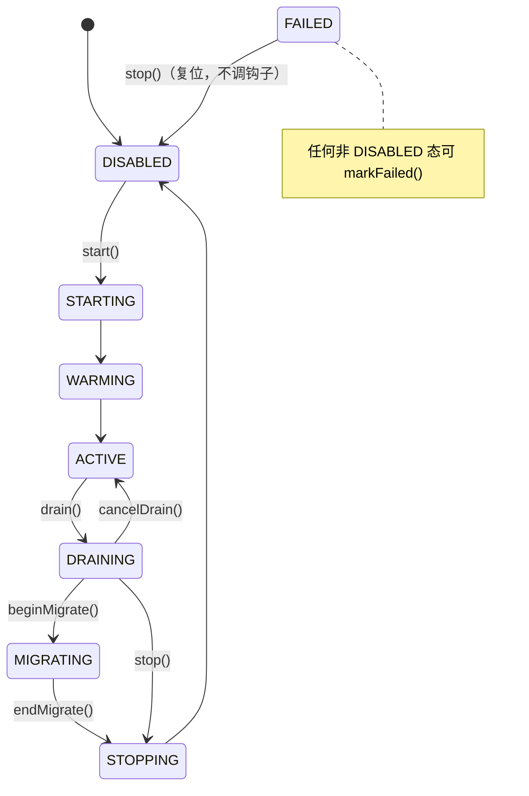
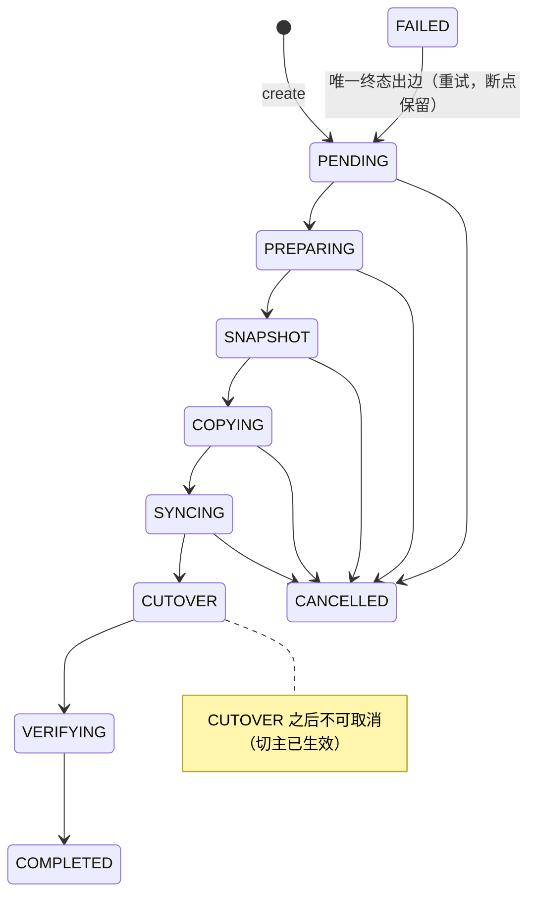

# 架构总览

> 本文是 runtime 模块的顶层架构说明。模块级细节见各子文档（[说明.md](说明.md) 导航）。

## 1. 定位与设计目标

runtime（distributed-runtime）是 ww 仓库内新增的**分布式应用基础运行时**框架，目标是：

1. **单节点可独立运行**（全能力自持），**多节点自动组成集群**（能力分布在任意节点子集）；
2. 任意 Capability 可在任意 Node 上启停、独立扩缩容、迁移；
3. 任何 Partition 都有明确 Owner，任何 Owner 变化都有 Epoch（Fencing）；
4. 任何迁移都可恢复（断点续跑），任何节点故障都能触发 Placement 重算；
5. 整个集群最终从**当前状态自动收敛到期望状态**（Desired → Actual Reconciliation）。

设计上借鉴 Kubernetes（Desired/Actual/Reconcile）、Redis Cluster（Partition/Sharding）、对象存储（Placement/Replication/Migration）与 Raft/Lease/Fencing 的思想，但自成一套 `Node + Capability + Partition + Placement + Epoch + Migration + Scheduler` 统一抽象。

**当前进度**：基础框架与真实能力接入均已完成——runtime-parent 聚合 **11 个 Maven 模块**（含数据面 runtime-data 与日志 runtime-log），**173 个主类 + 84 个测试类、8 张 PG 表、8 个 gRPC 服务（7 个已实现，PlacementWatch 仅契约）**。MOCK/CACHE/STORAGE 三种能力可编排、可迁移、可复制，并有退役（decommission）流程与日志采集/查询/实时流链路。历史评审与整改记录见 [运行时规模化专项审查报告.md](../运行时规模化专项审查报告.md)、[运行时整改分段实施计划.md](../运行时整改分段实施计划.md)。

## 2. 核心抽象

| 抽象 | 定义 | 落地 |
|---|---|---|
| **Node** | 物理计算资源容器，不等于角色；携带 host/grpcPort/weight/资源快照 | `NodeInfo`（record）、`NodeRuntime`、`rt_node` 表 |
| **Capability** | 可运行能力（MOCK/CACHE/STORAGE，预留 API/TASK） | `CapabilityModule` SPI、`CapabilityManager`、`rt_capability_state` 表；CACHE/STORAGE 实现在 runtime-data |
| **Partition** | 逻辑数据单元，`key → hash → partitionId`，默认 4096 个/能力 | `Partitioner`、`PartitionId` |
| **Placement** | 分区所有权映射（显式表，非计算式路由） | `PlacementEngine`、`PlacementStore`、`rt_partition_placement` 表 |
| **Epoch** | 所有权版本（Fencing Token），切主 +1，旧 Owner 写入被拒 | `Epoch`、`PlacementStore.cutover` CAS、`StaleEpochException` |
| **Migration** | 所有权转移：状态机 + gRPC 分片传输 + checkpoint | `MigrationEngine`、`rt_migration_task` 表 |
| **Scheduler** | Desired→Actual 收敛器，PG 租约竞选，无固定 Master | `ReconcileLoop`、`LeaseStore`、`rt_scheduler_lease` 表 |

## 3. 总体架构

```
                     PostgreSQL（控制面元数据，plain JDBC）
              rt_node / rt_capability_state / rt_partition_placement
              rt_scheduler_lease / rt_migration_task / rt_cluster_config
              rt_decommission / rt_log
                        │
              ┌─────────▼─────────┐
              │  Scheduler Leader  │   ← rt_scheduler_lease 单行租约 CAS 竞选
              │  ReconcileLoop     │      （任意节点可成为 Leader，无固定 Master）
              │  Placement Engine  │
              │  RebalancePlanner  │
              │  DecommissionDriver│
              └─────────┬─────────┘
                        │ Migration Plan（PartitionMove 列表）
      ┌─────────────────┼─────────────────┐
      ▼                 ▼                 ▼
 MigrationEngine   NodeCommandChannel  DesiredStateWriter
 （数据搬运+切主/   （START/STOP/FREEZE） （管理面只写期望态）
  副本提升）             │
      └─────────────────┼─────────────────┘
                        │ gRPC 集群网络（数据面）
   ┌──────────────┬─────┴──────┬──────────────┐
   ▼              ▼            ▼              ▼
Node A          Node B       Node C        Node D
[MOCK/CACHE/   [CACHE/      [STORAGE      [无能力]
 STORAGE]      STORAGE]     能力]
Membership ──── Membership ── Membership ──── Membership（gossip 心跳双向流，增量 ack）
```

每个节点进程 = `runtime-server`（Spring Boot 薄宿主）组装以下 Spring-free POJO 组件：

```
┌─────────────────────────── Node 进程（runtime-server） ───────────────────────────┐
│  REST : /rt/*（Admin API） /cache/*（CACHE 网关） /storage/*（S3 网关）            │
│  gRPC : Health / ClusterControl / Membership / Migration / Storage / Cache        │
│         / LogStream                                                              │
│                                                                                    │
│  NodeRuntime ──► NodeRegistry ◄── MembershipService（心跳/故障检测/事件）           │
│       │              ▲                    │                                        │
│  OsResourceMonitor   │                    ▼                                        │
│       │         CapabilityManager ◄── ReconcileLoop（Leader 时收敛）                │
│       ▼              │    ▲              │        │                               │
│  ResourceSnapshot    ▼    │         MigrationEngine（虚拟线程 + 限流）               │
│        Mock/Cache/Storage Capability      │                                        │
│           （runtime-data 实现）           ▼                                        │
│      CacheGateway / StorageGateway ──► PlacementView ◄── PlacementStore / Engine   │
│      StorageReplicator（写后异步复制）                                             │
│      DecommissionService / RuntimeLogBatchWriter（logback→LogBuffer→rt_log）      │
└────────────────────────────────────────────────────────────────────────────────────┘
```

## 4. 控制面 / 数据面严格分离

- **控制面**（PostgreSQL + Scheduler + gRPC 控制流）：Node/Membership/Capability/Placement/MigrationTask/Lease/Epoch 元数据。**数据库只是元数据事实源，禁止作为大数据搬运通道**。
- **数据面**（gRPC Streaming）：迁移分片流（4MB/片、SHA-256 checksum、ack 重发）。大数据一律 `A → gRPC Stream → B`。
- **管理面只写 Desired State**（`/rt/nodes/{id}/capabilities/{type}/desired`），实际状态由 Scheduler 收敛产生，禁止直接 UPDATE 底层状态。

## 5. 模块清单与分层

runtime-parent 聚合 11 个 Maven 模块（另有 `runtime-ui` 前端工程，产物注入 server 静态资源），分层如下：

| 层 | 模块 | 职责 | Spring? |
|---|---|---|---|
| 基础层 | `runtime-common` | 值对象/枚举/异常/时钟（纯 POJO，仅 slf4j） | 否（enforcer 禁止） |
| 基础层 | `runtime-proto` | 8 个 .proto 契约 + gRPC 生成代码 + GrpcServerHost | 否（enforcer 禁止） |
| 领域层 | `runtime-cluster` | 节点状态机/注册表（内存+JDBC）/资源监控/NodeRuntime/退役记录存储 | 否 |
| 领域层 | `runtime-membership` | gRPC 心跳双向流/gossip 视图合并/故障检测/事件 | 否 |
| 领域层 | `runtime-capability` | 能力 SPI + 8 态生命周期状态机 + desired/actual 存储 | 否 |
| 领域层 | `runtime-placement` | 加权 HRW/Partitioner/PlacementStore CAS/RebalancePlanner | 否 |
| 领域层 | `runtime-scheduler` | Leader 租约/ReconcileLoop/命令通道/DesiredStateWriter/退役驱动端口 | 否 |
| 领域层 | `runtime-migration` | 迁移 10 态状态机/引擎/gRPC 分片传输/断点续跑 | 否 |
| 数据面层 | `runtime-data` | CACHE/STORAGE 能力实现（引擎 + 网关 + 复制器 + 迁移适配），零 Spring | 否（enforcer 禁止） |
| 数据面层 | `runtime-log` | logback 采集 Appender + 缓冲 + 进程内总线（落库/SSE/gRPC 归宿主） | 否（enforcer 禁止） |
| 组装层 | `runtime-server` | 唯一 Spring 宿主：装配 + 启停编排 + REST/gRPC/SSE 暴露 | **是**（唯一豁免） |

**依赖方向铁律**：`server → {scheduler, migration, data, log, capability, placement, cluster, membership} → {proto, common}`；任何核心模块不得反向依赖 server，核心模块间通过端口接口（`PlacementView`、`MigrationCoordinator`、`DecommissionDriver`、`PeerDirectory`/`StateSink`、`PartitionDataAdapter`）解耦。详见 [11-依赖关系.md](11-依赖关系.md)。

## 6. 三大状态机

### 6.1 Node 生命周期（`NodeStateMachine`，5 态）



- 同态跃迁一律非法；`DEAD` 的**唯一合法出边是 JOINING**（节点重启 `register()`/误判暂停恢复 `NodeRuntime.reRegister()`，state_epoch 重置为 0）。
- 跃迁表提供反向索引 `legalPredecessors(to)`，供 `JdbcNodeRegistry.markState` 拼入 SQL `WHERE state IN (...)` 做单语句 CAS。
- 每次 `markState`/`tombstone` 使 `state_epoch` +1（乐观锁版本）。

### 6.2 Capability 生命周期（`CapabilityManager`，8 态）



- 钩子（start/warm/drain/stop）在命令线程同步调用，异常自动 `markFailed`；per-type 锁使不同能力互不阻塞。
- `freeze(boolean)` 是独立于状态机的维护开关（迁移前冻结停新写）。
- 幂等收敛入口 `convergeStart(type)` / `convergeStop(type)`：从任意中间态收敛到目标端（gRPC 超时误判后重试不死锁），调度命令一律走 converge 系。

### 6.3 Migration 任务状态机（`MigrationStateMachine`，10 态）



- 所有状态写入前必须经 `MigrationStateMachine.check` 校验，非法跃迁抛 `IllegalStateTransitionException`。
- 任务存储的 `transition` 以 `UPDATE ... WHERE state=?` CAS 写入，防并发修改。

## 7. 数据库表总览（PostgreSQL，全部幂等建表）

| 表 | 所属模块 | 主键 | 关键列 | 用途 |
|---|---|---|---|---|
| `rt_node` | cluster | node_id | state, state_epoch, weight, cpu/mem/disk 资源列, heartbeat_at | 节点注册表（含 DEAD 墓碑行） |
| `rt_cluster_config` | cluster | cfg_key | cfg_value, version | 集群配置 KV（预留，暂无读写实现） |
| `rt_decommission` | cluster | node_id | state(DRAINING/REMOVING/COMPLETED/FAILED), force_flag, detail, started/updated/completed_at | 节点退役进度记录 |
| `rt_capability_state` | capability | (node_id, capability) | desired, actual, updated_at | 期望态/实际态（收敛依据） |
| `rt_partition_placement` | placement | (capability, partition_id, node_id) | role, epoch, updated_at | 分区放置（v2 多行：每分区 1 PRIMARY + N−1 REPLICA；epoch 为 fencing 依据） |
| `rt_scheduler_lease` | scheduler | id（恒 1，CHECK 约束） | owner, expires_at_ms | Leader 租约（单行表 CAS） |
| `rt_migration_task` | migration | task_id（BIGSERIAL） | capability, partition_id, from/to_node, state, checkpoint_offset, items_done, checkpoint_json | 迁移任务与断点 |
| `rt_log` | server（DDL）/ runtime-log（采集） | id（BIGSERIAL） | level, logger/thread, message, stack_trace, node, created_at | 集群日志落库（时间戳/节点/级别索引） |

Schema 引导统一模式：`XxxSchema.bootstrap(DataSource)` 执行 classpath 下 `sql/rt_*.sql`（`CREATE TABLE IF NOT EXISTS` 幂等），并以 `pg_advisory_lock(4001, n)` 串行化跨节点并发建表（规避 PG 下 `CREATE TABLE IF NOT EXISTS` 的 pg_type 竞态）。锁编号：cluster=1、capability=2、placement=3、scheduler=4、migration=5、log=6。

## 8. gRPC 服务总览（package `runtime.v1`）

| 服务 | RPC | 模式 | 服务端实现 | 用途 |
|---|---|---|---|---|
| `Health` | `Check` | unary | server 模块 `HealthServer` | 存活检查（detail 含 leader 状态） |
| `ClusterControl` | `StartCapability` / `StopCapability` / `Freeze` | unary | server 模块 `ClusterControlServer`（走 converge） | 调度器→节点的能力生命周期命令 |
| `Membership` | `Heartbeat` | **双向流** | membership 模块 `MembershipService` | 周期心跳 + 视图版本化增量 ack（known_ack_version/ack_version） |
| `Membership` | `Watch` | 服务端流 | 同上 | 成员变更事件订阅 |
| `Migration` | `TransferStream` | **双向流** | migration 模块 `MigrationServer` | 目标端写入（ack 重发） |
| `Migration` | `FetchPartition` | 服务端流 | 同上 | 源端分片拉取（支持 from_checkpoint） |
| `Migration` | `ControlTask` | unary | 同上 | 任务控制（cancel） |
| `Migration` | `ReportProgress` | 客户端流 | 同上 | 进度上报 |
| `Migration` | `CountPartition` / `ClearPartition` | unary | 同上 | 源/目标端对账计数、迁移完成清理源端 |
| `Cache` | `ForwardPut/PutIfAbsent/Get/Delete` | unary | data 模块 `CacheGrpcServer` | CACHE 网关跨节点转发（含 fencing） |
| `Cache` | `ListKeys` / `CountKeys` | 服务端流 / unary | 同上 | 管理面 key 列举与前缀计数 |
| `Storage` | `ForwardPut` / `Replicate` | 客户端流 | data 模块 `StorageGrpcServer` | 大对象分块上传（网关转发 / 副本复制） |
| `Storage` | `ForwardGet` / `ListBucket` / `ListBucketNames` | 服务端流 | 同上 | 分块下载（含区间读）/ 列举 / 桶名 |
| `Storage` | `ForwardHead` / `ForwardDelete` / `ReplicateDelete` / `SyncBucket` / `CountObjects` | unary | 同上 | 元信息、删除、副本删、桶广播、计数 |
| `LogStream` | `Stream` | 服务端流 | server 模块 `LogStreamGrpcServer` | 跨节点日志流聚合（对端只推本地、不递归） |
| `PlacementWatch` | `WatchPlacements` | 服务端流 | **proto 已定义，实现为下一阶段** | 放置快照订阅 |

消息定义详见 [03-通信契约模块.md](03-通信契约模块.md)。

## 9. 一轮收敛时序（ReconcileLoop 核心流程）

```
Leader 节点（持有 rt_scheduler_lease 租约）每 reconcileIntervalMs（默认 2s）执行 runOnce()：

1. leaseStore.acquireOrRenew(self, ttl)   ──失败→ 本周期静默跳过（follower 待命）
2. 一次 capabilityStore.list() 快照 + sweepStaleJoiningOrphans（静默超 2×TTL 且无能力记录的 JOINING 孤儿 → tombstone）
3. for each CapabilityType（按名排序，逐类型 try/catch 隔离故障）:
   阶段1 集合计算：alive / desiredOn / actualOn / desiredAlive / capabilityActive / toStart / toStop
   阶段2 放置引导：primaries 空且 desiredAlive 非空
      → engine.compute(cap, desiredAlive, partitionCount, rfFor(cap))
      → replaceAll（含 REPLICA 多行，epoch=0，CACHE 用独立 cacheReplicationFactor）
   阶段3 冻结补偿（S5）：上周期曾判待下线、本周期 desired 回改的泄漏节点定向 freeze(false)
   阶段4 待上线：fanoutCommands 并发 startCapability（专用 command-exec 池，批间续约）→ 成功 setActual(ACTIVE)
   阶段5 待下线（非空则处理完 return）：
      并行 freeze(true) → computePrimaries(desiredAlive) → planner.plan 过滤 from∈toStop 的 moves
      → 目标持副本行走 promoteReplica 无损提升；其余端点就绪门控（目标能力须 ACTIVE）
      → migrateInBatches（批 256 + 批间续约）→ stillLeader 复核 → 批量 reassignReplicas
      → stopNode；失败进排空冷却（rebalanceCooldownMs 窗口内保持冻结不重复提交）
   阶段6 治愈或重平衡：
      (e1) 死主分区（from∉alive，免比例/冷却门控）：有存活副本 promoteReplica 免迁移；
           无副本走降级治愈迁移，但先过 healingGracePeriodMs 宽限期（押注节点重入，WARN 数据丢失窗口）
           → 治愈后 return（不占冷却预算）
      (e2) 常规扩容重平衡：migrateReady 门控 → shouldRebalance(比例≥minMoveRatio 且过 cooldown)
           → migrateInBatches → reassignReplicasBatch；失败也记预算防任务表爆炸
      (e3) 无 moves：topUpReplicas 补足缺失副本行（冷却节流，≤256 分区/周期）
4. decommission.advance()（仅 leader）：驱动 rt_decommission DRAINING→REMOVING→COMPLETED 状态机
5. Thread.sleep(min(renewIntervalMs, reconcileIntervalMs))；快照缓存（S17，1s TTL）周期末作废
```

**幂等保证**：命令失败不抛异常（返回 false 下周期重试）；迁移任务复用活动任务不重复建；分片导入 upsert 幂等；切主以 epoch CAS 防竞态；长操作（迁移/命令扇出）后 `stillLeader()` 复核租约，失租即中止副作用。

## 10. Fencing 闭环（防 Stale Owner / Split Brain）

```
key ──Partitioner(MD5 前 8 字节 % 4096)──► partition
partition ──PlacementStore.primaries──► owner(node, epoch)

写入路径（以 MockCapability.put 为例）：
  view.owner(cap, partition)
    ├─ 无属主                       → StaleEpochException
    ├─ 属主 ≠ self                  → StaleEpochException
    └─ 属主 epoch ≠ 请求 epoch      → StaleEpochException   ← 旧 Owner 的陈旧写入被拒
    └─ 通过 → data.put + 计数

切主路径：MigrationEngine CUTOVER 阶段
  placementStore.cutover(cap, partition, toNode, expectedEpoch)
    UPDATE ... SET node=?, epoch=epoch+1
    WHERE capability=? AND partition_id=? AND epoch=? AND node<>?   ← CAS
```

## 11. 故障恢复策略

| 场景 | 策略 |
|---|---|
| 节点宕机 | 心跳静默 > suspectTimeout（默认 3s）→ SUSPECTED；> deadTimeout（默认 6s）→ DEAD；Leader 侧 Reconcile 治愈：有存活副本 → `promoteReplica` 无损提升（免迁移）；无副本 → 过 `healingGracePeriodMs`（默认 30s，押注节点重启重入）后降级迁移（数据丢失窗口 WARN） |
| 节点从目录消失且 DEAD | membership S10 驱逐：`vanishedDeadSince` 连续计时超过 10×deadTimeout → 从视图移除，防退役/缩容墓碑行无限增长 |
| 节点假死恢复（GC 暂停/误判 DEAD） | `NodeRuntime` 心跳自检（每 5 拍）：注册表本节点 DEAD → `reRegister()`（DEAD→JOINING→ACTIVE，epoch 重置）；成员视图靠直证例外覆盖陈旧 DEAD |
| Leader 宕机 | 租约过期（默认 TTL 10s）→ 其余节点 CAS 抢占接管（实测 ≤15s）；长操作后 stillLeader 复核防重叠副作用 |
| 迁移中断 | 任务状态 + checkpoint_offset + checkpoint_json（含键型游标/epoch）持久化；重启后 `MigrationEngine.resumeAll()` 续跑（**跨未冻结窗口一律从零幂等重放**，P0-1） |
| Split Brain | 旧 Owner 持旧 epoch 写入 → 写路径统一经 PlacementView 校验 → `StaleEpochException` 拒绝 |
| 控制面 DB 不可用 | 启动期 fail-fast（PG SELECT 1 检查）；运行期数据面以最后已知 placement 降级 |
| 并发建表 | `pg_advisory_lock(4001, n)` 串行化 6 个 Schema bootstrap |
| 节点退役 | `POST /rt/nodes/{id}/decommission`（最后主持有者需 force）→ desired 排空 → Leader `advance()` 推进迁移/清放置/删能力记录 → LEAVING→DEAD→COMPLETED |

## 12. 一致性分级

- **强一致**：Ownership/Placement epoch（CAS）、Lease（单行表乐观锁）、Migration 状态（WHERE state=? CAS）、Node state_epoch（乐观锁 + 重试）。
- **最终一致**：成员视图传播（gossip 悲观合并 + 版本化增量 ack）、资源统计、STORAGE 副本（写后复制 + backlog 重放 + 周期对账 + 僵尸 prune，读永远走 PRIMARY；**半同步默认开启**：至少一副本 ack 才应答，超时可配 fail-closed）、调谐收敛本身（周期性幂等逼近）。
- **迁移一致性（P0-1）**：数据阶段源分区写冻结（键型游标 + TTL 自愈）+ 断点从零重放 + 落盘后二次 fencing；迁移窗口内该分区写不可用，到期自动恢复。

## 13. 关键设计决策速记

1. **POJO 核心 + 薄 Spring 宿主**：server 以外的 10 个核心模块零 Spring/JPA/Caffeine（maven-enforcer 构建期门禁），未来可脱离 Spring 独立运行；server 是唯一允许 Spring 的模块，配置经 `RuntimeProperties` 翻译为构造参数（防腐层）。
2. **Netty 钉版 4.1.100.Final**：grpc-netty 1.62.x 与 Spring Boot 4 BOM 管理的 Netty 4.2.x 不兼容（HTTP/2 HPACK 解码错误/巨型消息），runtime-parent 的 dependencyManagement 覆盖之。
3. **哈希算法为 MD5 前 8 字节构造 64 位值**（非 xxHash）：`Partitioner` 与 `WeightedRendezvousHash` 同族，保证 key→partition 与 partition→owner 两级映射稳定可复现。
4. **加权 HRW 公式 `score = -ln(h) × weight`**：相对旧 common-cluster 的 `RendezvousHash`（已随 common 家族合并移除）修正了两处数学错误（Long.MAX_VALUE 除数、权重方向），权重比例≈分得分区比例。
5. **租约表含 `leader_epoch`（P1-2）**：Leader 唯一性靠 `owner + expires_at_ms`，控制面副作用以单调 `leader_epoch` 作 fencing token；数据面 fencing 仍专属 Placement 表 epoch。
6. **desired 只允许 ACTIVE/DISABLED 两个开关值**：中间态由节点状态机自治产出，管理面不可指定；且带"清空最后服务节点保护"；首启用 `setInitialDesired` 写入（已有记录不覆盖，防 env 复活管理面决策）。
7. **本模块不做 xxHash/4096 硬编码**：partitionCount 可配置（默认 4096 为设计基准）。
8. **副本复制不走 MigrationEngine**：副本数据由能力侧 `StorageReplicator`（写后异步 + 对账）与调度器 `reassignReplicas` 补齐；MigrationEngine 仅承担主迁移（`PromoteReplica` 场景直接提升，零搬运）。
9. **CACHE 与 STORAGE 副本数解耦**：`replication-factor`（STORAGE，建议 2）与 `capabilities.cache-replication-factor`（默认 1）独立配置——CACHE 内存态多副本会产生幽灵副本开销。
10. **成员心跳带宽 O(N²)→变更期 O(N²)**：视图版本化（S1②）——ack 携带 `ack_version`，请求方回带 `known_ack_version`，一致则回空 members，故障检测时序不变。
