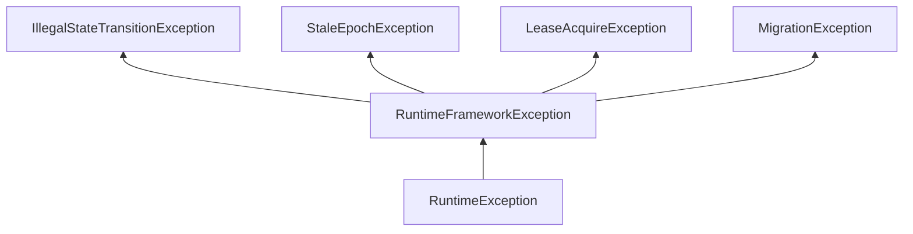

# runtime-common 模块

> 包路径：`com.ww.runtime.common` ｜ 源码：`runtime/common/src/main/java/com/ww/runtime/common/`（19 个源文件）
> 定位：**运行时基础库——值对象、枚举、错误体系与时钟（纯 POJO，零第三方依赖，仅 slf4j）**。是整个框架的"词汇表"层。

## 1. 模块职责

- 定义所有模块共用的**不可变值对象**（record）：`NodeId`/`PartitionId`/`Epoch`/`Version`/`NodeInfo`/`ResourceSnapshot`；
- 定义**状态枚举**：`NodeState`/`CapabilityState`/`PlacementRole`/`MigrationTaskState`/`CapabilityType`；
- 定义**统一异常体系**（unchecked，根为 `RuntimeFrameworkException`）；
- 定义**时钟抽象**（`Clock`/`SystemClock`/`TestClock`），所有超时/租约/心跳计时必须经此时钟，禁止直接调用系统时间 API（保证可测试性）。

## 2. Maven 坐标与依赖

- 坐标：`com.ww:runtime-common:1.0-SNAPSHOT`（父：`runtime-parent`）
- 依赖：`org.slf4j:slf4j-api`（compile）；junit-jupiter / assertj-core（test）
- **构建门禁**：`maven-enforcer-plugin` bannedDependencies 禁止引入 `org.springframework:*`、`jakarta/javax.persistence:*`、Caffeine —— 保证该模块可被任意子模块无副作用依赖。

## 3. 值对象（Java record，紧凑构造器校验，fail-fast）

### 3.1 NodeId

| 项 | 说明 |
|---|---|
| 字段 | `String value` |
| 校验 | 非 null 且非 blank，否则 `IllegalArgumentException("NodeId.value must not be null or blank")` |
| 方法 | `static NodeId of(String)`；`toString()` 直接返回 value（便于日志/序列化） |
| 用途 | 集群节点唯一标识，贯穿 membership/cluster/migration |

### 3.2 PartitionId

| 项 | 说明 |
|---|---|
| 字段 | `int value` |
| 校验 | `value >= 0` |
| 方法 | `static PartitionId of(int)`；`toString()` 返回数字字符串 |
| 用途 | 分区/分片标识（placement/migration） |

### 3.3 Epoch（Fencing Token）

| 项 | 说明 |
|---|---|
| 字段 | `long value`（>= 0） |
| 方法 | `static Epoch of(long)`；`boolean isStalerThan(Epoch other)`（`this < other`） |
| 用途 | 单调纪元，防过期消息/过期 Owner 写入；配合 `StaleEpochException` |

### 3.4 Version

- 字段 `long value`（>= 0）；通用单调递增修改序号。
- 与 Epoch 的区别：Epoch 表"所有权任期"，Version 表"数据修订号"。

### 3.5 ResourceSnapshot

| 项 | 说明 |
|---|---|
| 字段 | `cpuPercent, memTotalBytes, memUsedBytes, diskTotalBytes, diskUsedBytes, updatedAtMillis` |
| 校验 | cpuPercent 有限且 ∈ [0,100]（拒绝 NaN/Infinity）；内存/磁盘 used ∈ [0, total] |
| 方法 | `static of(...)`；`memUsedRatio()` / `diskUsedRatio()`（total=0 返回 0.0 防除零） |
| 用途 | 节点资源快照：placement 调度权重计算、membership 心跳上报 |

### 3.6 NodeInfo

| 项 | 说明 |
|---|---|
| 字段 | `NodeId id, String host, int grpcPort, NodeState state, long stateEpoch, double weight, ResourceSnapshot resources` |
| 校验 | id/host/state/resources 非空；grpcPort ∈ [0,65535]；weight 有限且 > 0 |
| 方法 | `static NodeInfo of(...)` |
| 用途 | 节点静态/动态信息聚合，membership 心跳与 placement 决策的核心载体 |

## 4. 时钟抽象

| 类/接口 | 说明 |
|---|---|
| `Clock`（interface） | `long nowMillis()`；所有超时/租约/心跳计时的唯一入口 |
| `SystemClock` | `final` 单例（`instance()`），返回 `System.currentTimeMillis()` |
| `TestClock` | 可变测试时钟：`setMillis(long)` / `advance(long)`（可负数回拨）；非线程安全，仅测试用 |

## 5. 枚举

| 枚举 | 常量（顺序） | 备注 |
|---|---|---|
| `NodeState` | `JOINING, ACTIVE, SUSPECTED, DEAD, LEAVING` | 节点生命周期，跃迁表见 [04-集群模块.md](04-集群模块.md) |
| `CapabilityState` | `DISABLED, STARTING, WARMING, ACTIVE, DRAINING, MIGRATING, STOPPING, FAILED` | 能力 8 态状态机 |
| `PlacementRole` | `PRIMARY, REPLICA` | 分区放置角色 |
| `MigrationTaskState` | `PENDING, PREPARING, SNAPSHOT, COPYING, SYNCING, CUTOVER, VERIFYING, COMPLETED, FAILED, CANCELLED` | 迁移任务 10 态 |
| `CapabilityType` | `MOCK("mock")`, `CACHE("cache")`, `STORAGE("storage")` | 双名解析：`parse(String)` / `of(alias)` 支持 name/alias/大小写/空格，未知抛 `IllegalArgumentException`；预留 API/TASK 等扩展 |

## 6. 异常体系（unchecked）

| 异常 | 携带信息 | 抛出场景 |
|---|---|---|
| `RuntimeFrameworkException` | message (+cause) | 框架错误根（如 SQLException 包装） |
| `IllegalStateTransitionException` | `from()` / `to()` (+detail) | 三个状态机收到不允许跃迁时 |
| `StaleEpochException` | `expectedEpoch()` / `actualEpoch()` | 消息纪元落后于当前纪元（fencing 拒绝） |
| `LeaseAcquireException` | message | 租约获取失败 |
| `MigrationException` | message (+cause) | 迁移任务错误（CAS 失败/校验失败/不收敛等） |

## 7. 与其他模块的关系

- 被除 proto 外的**全部 9 个模块**依赖（cluster/membership/capability/placement/scheduler/migration/log/data/server）。
- proto 与 common 是平级基础层（proto 不依赖 common，二者共同构成最底层）。
- 详见 [11-依赖关系.md](11-依赖关系.md)。

## 8. 测试覆盖（4 个测试类）

| 测试类 | 覆盖点 |
|---|---|
| `ValueObjectsTest` | 全部值对象相等性/hashCode/非法参数拒绝（null id、负分区、NaN cpu、used>total、grpcPort=65536、weight=0 等）；`Epoch.isStalerThan`；ratio 计算 |
| `ClocksTest` | TestClock 默认 0/set/advance（含负回拨）；SystemClock 真实推进 + 单例 |
| `EnumsTest` | 四个状态枚举常量顺序精确断言；`CapabilityType.parse` 接受 name/alias/大小写/空格、拒绝未知/null |
| `ExceptionsTest` | 异常继承链；`IllegalStateTransitionException` from/to；`StaleEpochException` expected/actual 与消息格式 |
